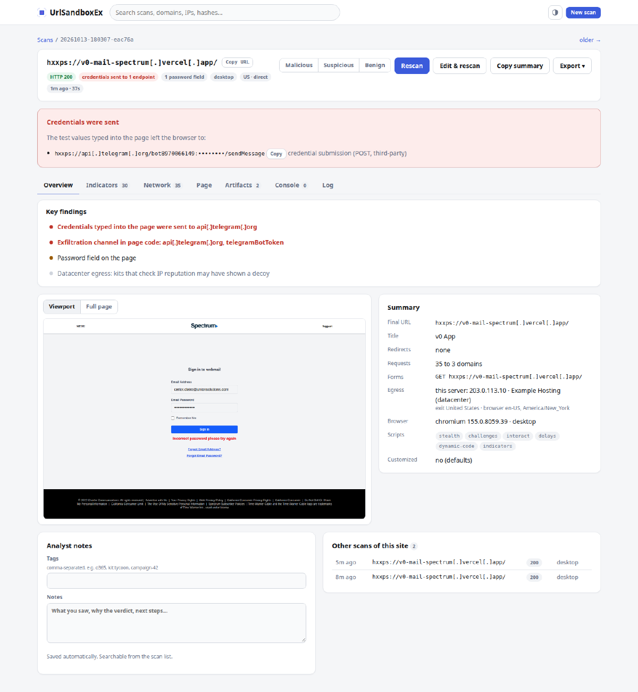
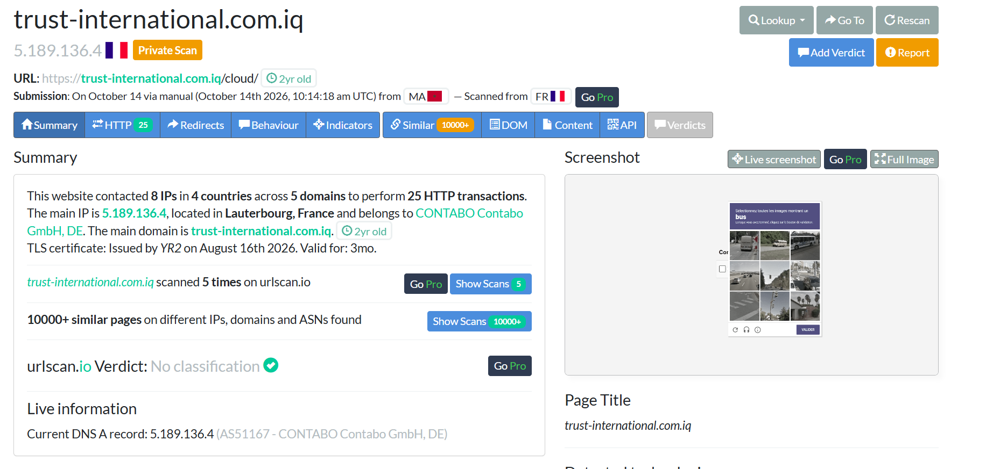
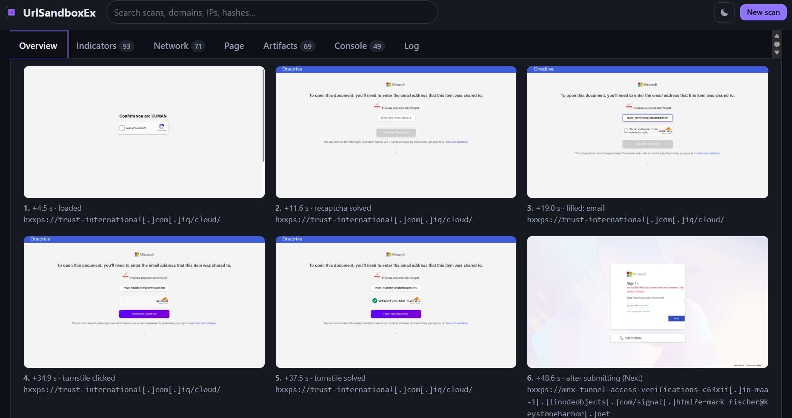
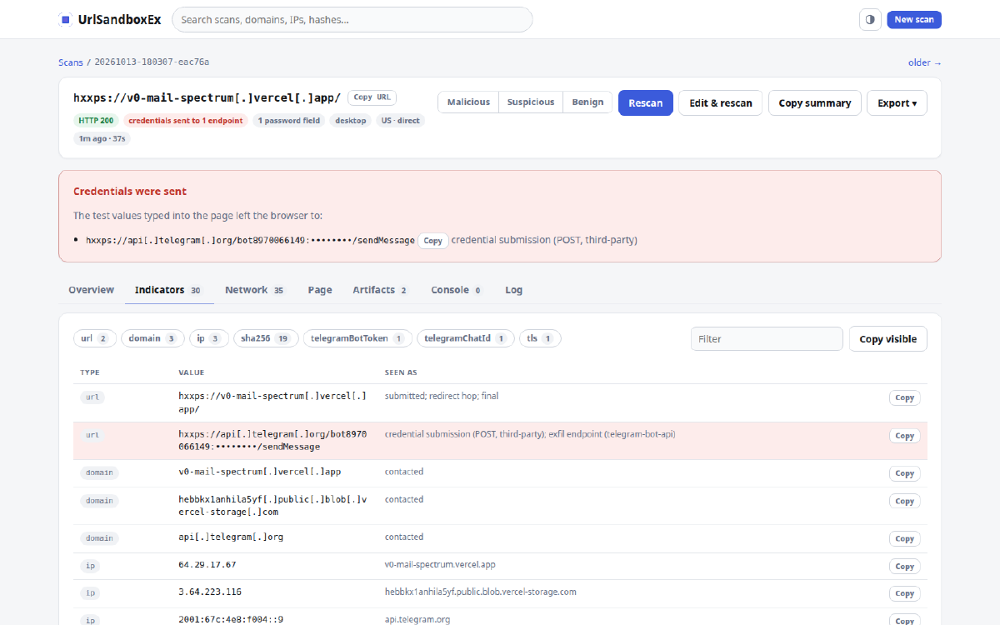
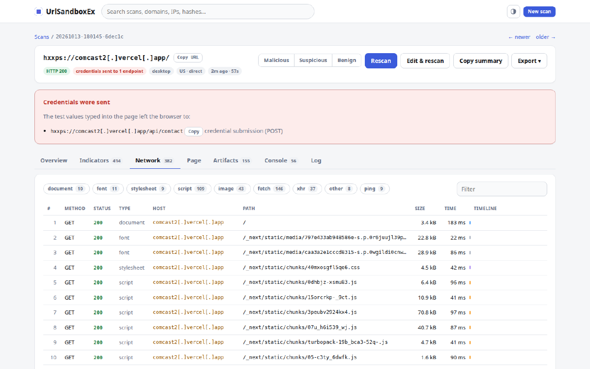

# UrlSandboxEx

A self-hosted URL sandbox for phishing analysis. It opens a URL in a jailed
Chrome that behaves like the victim, gets past CAPTCHAs, behaviour checks
and delays, and records what the victim would see: screenshots, the full
network trace, where typed credentials went, and the indicators. 

This project was created with the help of AI.

<p align="center">

</p>

## Compared to Urlscan

The comparison was done using a live OneDrive phishing kit uses
both a Google reCAPTCHA v2 in front of the page, then a Cloudflare
Turnstile, with the
"Download Document" button disabled until it passes. 

urlscan scanned it and stopped at the reCAPTCHA image
puzzle and wasn't classified as malicious:



meanwhile UrlSandboxEx completed the captchas and went through until the phishing page was shown.

  


## Quick start

Ubuntu 24.04, Node.js 22.

```
npm install && npm link                                # installs the urlsandboxex command
sudo deploy/setup.sh && sudo usermod -aG sbx "$USER"   # then log in again
urlsandboxex https://example.com                       # scan, summary in the terminal
node web/server.js                                     # web UI on http://127.0.0.1:8090
```

Set `egress.residentialProxy` in `sbx.config.jsonc` to get past IP
reputation checks. Without it, scans leave from this server's IP.

## Features

- Personas (desktop, Android, iPhone, Firefox, Safari) consistent down to
  Workers and iframes; language and timezone follow the exit IP.
- Gets past Turnstile, reCAPTCHA and hCaptcha checkboxes, reCAPTCHA image
  puzzles (object recognition on the server; 6 of 7 live Google puzzles
  solved and accepted by Google from a datacenter IP), fake CAPTCHAs,
  sliders, press-and-hold, wizards and delayed reveals.
- Completes multi-step logins (email, password, one-time code, wallet
  recovery phrase) like a victim and reports where each value was sent,
  Telegram bots included; stops when the kit hands over to the real
  service.
- Records every state the page goes through: a screenshot each time it
  changes (gate, CAPTCHA, login, error, hand-off), not only the last one.
- Reports delivered files, ClickFix clipboard writes, exfil channels
  (Telegram, webhooks), QR codes and generated code from the page, its
  iframes and Workers.
- Web UI with triage, search over every indicator, batches of up to 1000
  URLs, per-scan customization and profiles. The CLI does the same.
- Every installation generates its own fingerprint (screen, window,
  pace, typed identities); `urlsandboxex fingerprint rotate` changes it when a kit
  starts flagging it, and your own profile is used exactly as given.
- Each scan runs in a rootless bubblewrap jail with no network but a
  filtering proxy. Nothing is shared publicly.

| | |
|---|---|
|  Scan list: findings per kit |  A batch of live kits: credentials sent on 6 sites |
|  Indicators: the Telegram exfil endpoint and bot |  Network: every request of a two-step kit |
|  Customize scripts per scan |   |

## Extending it

Everything beyond opening and capturing the page is a script. A script
observes the page, its traffic and generated code without the page being
able to tell, and reports findings and tags:

```js
// my-kit: flag lures that stage a PowerShell command.
module.exports = {
  name: "my-kit",
  when: { text: /verify you are human/i },
  setup(api) {
    api.code.on((c) => { if (/powershell/i.test(c.source)) api.emit.finding("bad", "PowerShell in generated code"); });
  },
  async run(api) {
    if ((await api.page.query("input[type=password]")).length) api.emit.tag("credential-form");
  },
};
```

`urlsandboxex script check FILE` tells you whether a script makes the sandbox
detectable. See [Script API](docs/api.md).

## Limitations

No GPU on this host (software WebGL); hCaptcha puzzles are reported, not
solved; device-motion gestures are not simulated;
`outerWidth` can read 0 in an inline script right after a cross-site hop.

## Documentation

[docs/](docs/README.md): getting started, command line, web UI,
configuration, script API, scripts, output, architecture, testing,
troubleshooting.
