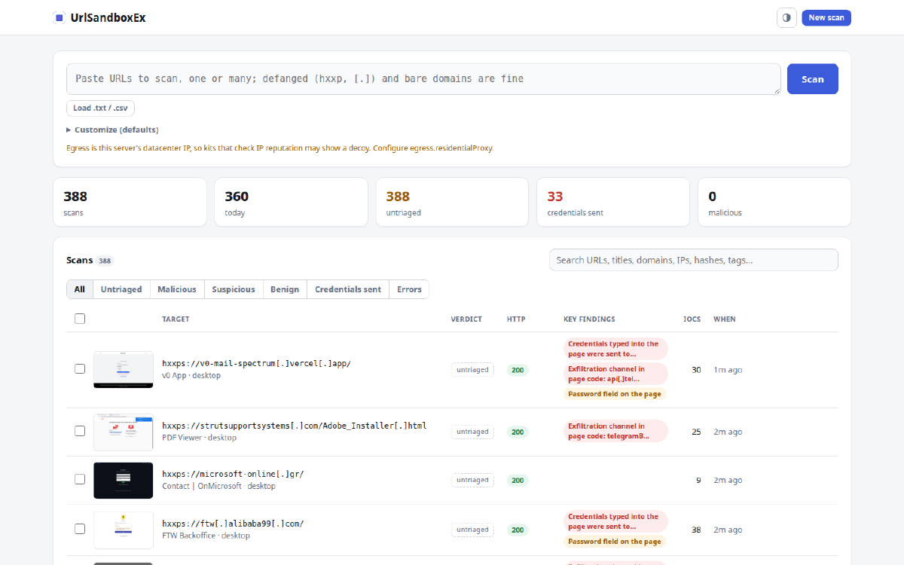
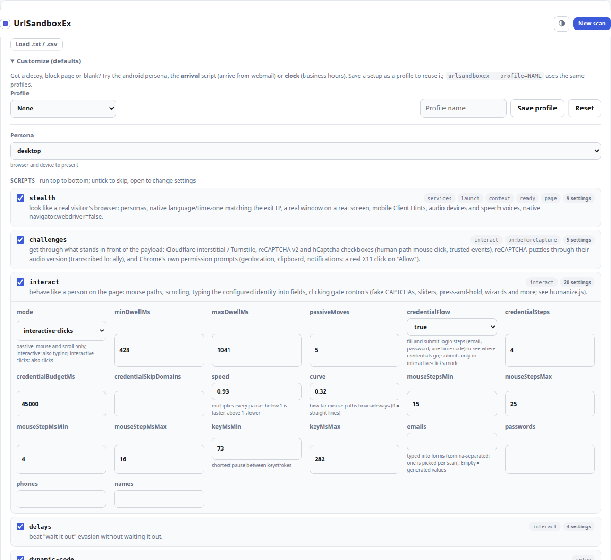
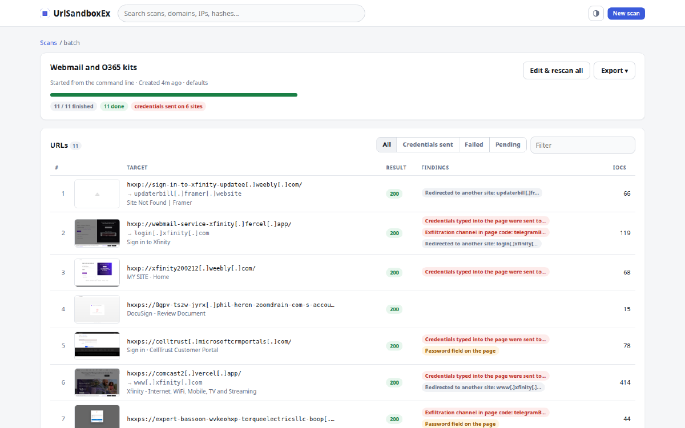

# Web UI

```
node web/server.js      # 127.0.0.1:8090, reach it over an SSH tunnel
```



## Scanning

Paste URLs in the box, load a `.txt`/`.csv`, or drop a file anywhere on
the page. Extraction works as on the [command line](cli.md). One URL opens
a live progress page that becomes the report; several make a batch.

## Customize



Under the URL box: the persona, which scripts run (untick to skip, open to
edit settings; changed fields are highlighted) and free-form
`section.key=value` overrides. Save it as a profile; the CLI uses the same
profiles (`--profile=NAME`). Only installed scripts appear: built-ins,
`examples/` and `scriptDirs`. The UI never accepts code.

## Reports

Key findings come first, worst first: credentials sent, delivered files,
clipboard commands, exfil channels, script findings, then lower-severity
signals. Each links to its evidence.

| Tab | Shows |
|---|---|
| Overview | findings, screenshots, summary, redirects, notes, other scans of the site, page states (a screenshot each time the page changed: gate, CAPTCHA, login, error, hand-off) |
| Indicators | indicators by type; copy, save the file behind a hash, CSV/JSON |
| Network | every request with headers, bodies and a timeline |
| Page | forms, cookies, storage, WebSocket frames, links |
| Artifacts | HAR, DOM, egress log, script files, downloaded samples |
| Console, Log | console messages; time per phase and script log |

Rescan repeats the scan; Edit & rescan opens the form prefilled. Copy
summary copies a Markdown summary.

## Triage and search

Set a verdict (malicious, suspicious, benign), tags and notes; they save
as you type. The scan list filters by verdict, credentials sent and
errors, and searches URLs, titles, tags, notes and every indicator value
(defanged input works). Select rows to set a verdict, export indicators,
rescan or delete.

## Batches



Live progress, a row per URL, Cancel queued, Retry failed, and exports
(HTML, Markdown, summary CSV, indicators CSV/JSON). Batches resume after a
restart. `web.maxConcurrent` sets how many scans run at once; single
scans go first.

## Access

No login: the server listens on loopback. Unknown Host headers (DNS
rebinding) and cross-origin POSTs are refused; add reverse-proxy names to
`web.allowedHosts`. Page content is escaped, URLs defanged and never
linked, artifacts served as downloads, with a strict CSP. Activity is
logged to `outDir/audit.jsonl`.
